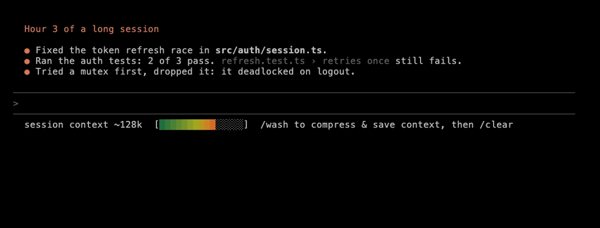

# Context Carwash

*Long Claude Code and Codex sessions get slow and forgetful. Run it through the wash: keep what matters, drop the rest, start fresh.*



Context Carwash adds a line to Claude Code in your terminal that:

1. **The Meter:** shows the current conversation's context size.
2. **/wash:** lets you compress your context and start a new session without losing important details.

It works in Codex too: see [Codex](#codex).

Pretty simple app, but I've found it helpful. Everything is local, but you can share your token savings anonymously with me if you'd like with `npx context-carwash stats --share`.

## Install

You'll need Node 18 or later.

```sh
npx context-carwash install
```

It shows you what it's going to change and asks before doing anything. Then start a new Claude Code session and you're set. If you use Codex as well, it sets that up in the same go.

When there's a new version, a line under the meter will tell you. To update, run `npx context-carwash@latest install`.

Under the hood, it adds a status line and three hooks to `~/.claude/settings.json` (after whatever you already have there) and a `/wash` command in `~/.claude/skills/wash`. For Codex, it adds three hooks to `~/.codex/hooks.json` and a `$wash` command in `~/.codex/skills/wash`.

## The Meter

```text
session context ~136k  [██████████░░░░░]  /wash to compress & save context, then /clear keeps compressed context
```

The number is roughly how many tokens your conversation is using (Claude Code's estimate). The bar shows how full the context window is and changes colour as it fills up. In a narrow window the text shortens to fit. It's just a meter, so it never does anything on its own.

## /wash

1. Type `/wash`. Claude writes a short brief: what you're working on, where things stand, and what's next. The status line switches to `Brief ready ✓`.
2. Type `/clear`. Your new session starts with the brief already loaded.

Your old conversation isn't gone. You can still find it in `/resume`.

| Command | What it does |
|---|---|
| `/wash` | Write a `mid` brief |
| `/wash light` | Goal, current state, next step |
| `/wash mid` | Adds constraints, decisions, state detail, pitfalls |
| `/wash detailed` | Adds rationale, history, test results, risks, a step checklist |
| `/wash discard` | Drop the brief. `/clear` is a normal clear again |
| `/wash load [id]` | Make a waiting brief the one your next `/clear` uses |
| `/wash stats` | How much context your washes have saved |
| `/wash help` | Explain the meter and these options |

A few things worth knowing:

- You can tell Claude what to focus on: `/wash mid focus on the failing test`.
- If you `/clear` without a brief ready, it's just a normal clear.
- Writing a brief is a normal Claude reply, so it uses some tokens. `help`, `discard` and `load` are free.
- Bigger conversations get bigger briefs. `/wash help` shows the size limit for each level.
- Closed the terminal before you got to `/clear`? Run `claude` in the same folder and your brief loads. If there's more than one waiting, it'll list them so you can pick with `/wash load <id>`.
- Briefs expire after 48 hours.

## Codex

If you have Codex, `install` sets it up too. It works the same way, with a few differences:

- The command is `$wash` (Codex keeps `/` for its own commands). Same options: `$wash light`, `$wash discard`, `$wash help` and so on.
- Codex asks you to approve new hooks before it runs them. The first time you start Codex after installing, choose **Trust all and continue**.
- After `/clear`, send your next message (even just "continue"). The brief loads with it, because that's when Codex starts the new session.
- The meter shows up as a line after each reply, because Codex's status line can only show its own items:
  `session context ~70k  [████░░░░░░░░░░░]  $wash to compress, then /clear`
  The bar is in colour from Codex 0.162.0 on (plain text before that, or with `NO_COLOR`). It's shown to you only, never sent to the model, so it costs no tokens.
- A brief written in Claude Code isn't picked up by Codex on its own, and the other way round. To use one anyway, run `$wash load <id>` (or `/wash load <id>`).
- `codex exec` runs never use up a brief.

## Stats

```sh
npx context-carwash stats
```

```text
Carwash stats, since 3 Oct 2026 (12 days)

  Briefs written              7  (light 1 · mid 5 · detailed 1)
  Started fresh with one      6
  Prompts in fresh sessions   94  (410 requests to Claude)
  Context not re-sent         ~11M tokens  (at most ~21M tokens)
  Spent writing briefs        ~0.9M tokens
  Net saved                   ~10M tokens  (at most ~20M tokens)
```

Every request to Claude or Codex sends the whole conversation again. After a wash, each request starts from the small brief instead, so Carwash counts the requests you actually made and adds up the difference. Counting stops where the old conversation would have filled up and compacted on its own.

You wouldn't have kept going in the old conversation forever, so the main number only counts the first part of the prompts after each wash. That's two-thirds to begin with. Carwash then adjusts it by looking at how far your own past conversations went once they were that big, so if you usually clear around 300k, a wash at 300k counts for less. Anything the fresh conversation had to read again, like a file the old one already had open, is taken off too. "At most" counts every prompt. All of this is worked out on your computer from Claude Code's own history files, and only a few numbers per conversation are kept.

Repeated context is charged at about a tenth of the price, so in dollars you're saving roughly a tenth of these numbers. You can also see this inside Claude Code with `/wash stats`.

If you run `stats --share`, it shows you exactly what it would send before asking.

## Something not working?

```sh
npx context-carwash doctor
```

This checks that everything's still installed and working, and shows your versions and any recent errors. Paste the output into a [new issue](https://github.com/Spobi/context-carwash/issues/new) and I'll take a look. Issues are public and errors can include folder names, so give it a quick read first.

## Where things are kept

Your briefs, stats and error logs live in `~/.carwash`, and only you can read them. Nothing about you gets uploaded. Once a day, Carwash checks npm for a newer version. If you'd rather it didn't, set `CARWASH_NO_UPDATE_CHECK=1`.

## Uninstall

```sh
npx context-carwash uninstall
```

This puts `settings.json` back exactly as it was. If you've edited the file since installing, it only removes Carwash's status line and hooks and leaves your changes alone. Codex's `hooks.json` gets the same treatment. It also removes the `/wash` and `$wash` commands and deletes `~/.carwash`, including any waiting briefs and your stats.

## Platforms

Built and tested on macOS, with Claude Code and with Codex. Automated tests also run on Linux and Windows, but I haven't tried those by hand yet.

## License

MIT
